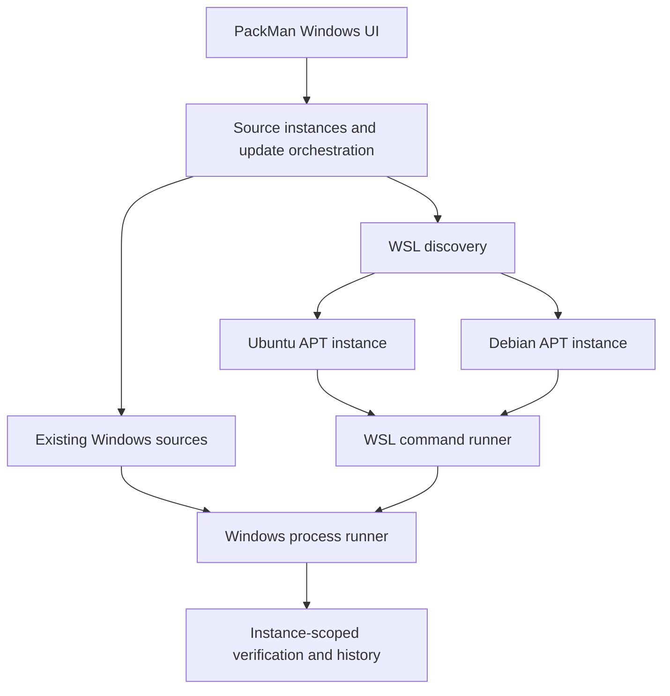

# PackMan for Windows: point-release review and WSL2 proposal

**Reviewed 26 November 2026 | Baseline: `main` at `8439703` (Windows 1.9.0)**

## Recommendation

Ship **1.9.1 as a reliability and responsiveness release**, with a small search/filter improvement if time permits. Version 1.9 already has the right foundations: concurrent source scans, explicit package identity, post-update verification, recovery actions, update history, cache previews, selective elevation and tested self-update packaging. Avoid replacing the WPF/MVVM architecture or making all installers run concurrently.

WSL2 support is feasible without a Linux agent or a separate application. However, supporting multiple distributions requires an instance-aware source model, not just an additional `SourceId`. If WSL is the headline feature, use a separate 1.10 milestone, beginning with Ubuntu/Debian APT. A small opt-in, read-only discovery preview could ship in 1.9.1 if desired, without granting any Linux administrative permissions.

## Evidence and scope

- Reviewed the local Windows application, package adapters, process execution, settings, activity/history, UI bindings, and CI/release workflows. The working tree was clean at the start.
- `dotnet test windows/tests/PackMan.Tests/PackMan.Tests.csproj --no-restore --verbosity minimal`: **168 passed, 0 failed, 0 skipped** using the locally installed .NET 10 SDK.
- Seven additional targeted regression checks using mocked sources/runners all failed their desired-behaviour assertions, confirming the defects below. Temporary test code was removed after the checks. No actual packages were installed or upgraded.
- WSL enumeration returned `Wsl/E_ACCESSDENIED` in this execution environment. No live distribution, APT operation, UAC flow, packaged self-update or interactive WPF UI test was exercised. WSL recommendations are based on the application architecture and official command documentation; performance opportunities are based on code inspection, not profiling.

## Release-blocking correctness fixes

| Priority | Finding | Impact | Evidence |
|---|---|---|---|
| P1 | Stale package details can still install removed rows | A disabled source, ignored package or old scan result can be acted on through an open Activity window. | Regression reproduced |
| P1 | Scanner failures can be mistaken for successful empty results | Scoop, npm and pipx can report a clean scan despite unusable or unrecognised output. | Three regressions reproduced |
| P1 | Source changes leave a previously clean summary intact | Users may be told that every enabled source succeeded when a new source has not yet been scanned. | Regression reproduced |
| P2 | Ignore rules are not repository-scoped | Ignoring one WinGet package can silently hide a distinct package with the same ID from another repository on the next scan. | Regression reproduced |
| P2 | Present-but-broken tools are treated as missing | The Install action can run an installer despite a configuration error instead of offering the appropriate repair. | Regression reproduced |

### 1. Reject stale package actions

The modeless Activity window binds its actions to `SelectedPackage`. A source can be disabled, an executable changed or a new scan completed while the window remains open. Removing the row does not invalidate that reference. `RetryUpdate`, `UpdateInteractive` and `StartUpdates` validate actionability but do not require a current row/context. In the regression, disabling npm removed its only row, yet invoking the old details action called the mocked installer once.

**Fix:** centralise validation of install requests immediately before starting work: the row must be part of the current scan/collection, have a valid current source context, and belong to an enabled source. Clear or mark `SelectedPackage` as historical when its row is removed. Keep historical details readable, but make reinstall explicitly use fresh scan data. Verification-only actions may be allowed on historical attempts after resolving a fresh appropriate context, never by inadvertently reusing obsolete execution details. Use the same guard for context menu actions. Test disabling, ignoring, changing executables, a fresh scan and multiple open Activity windows.

Code: [MainViewModel.Details.cs:57](windows/src/PackMan/ViewModels/MainViewModel.Details.cs#L57), [MainViewModel.cs:624](windows/src/PackMan/ViewModels/MainViewModel.cs#L624), [MainViewModel.cs:1054](windows/src/PackMan/ViewModels/MainViewModel.cs#L1054), [ActivityWindow.xaml](windows/src/PackMan/ActivityWindow.xaml).

### 2. Do not report unrecognised results as clean

- **Scoop:** `ScoopStatusParser.Parse` silently ignores everything before the table header and has no check that it ever found a valid header. An unrecognised output fixture produced zero updates and zero issues. Recognise valid no-update messages and tables; return an explicit parsing issue for unknown output. Verification already checks for the installed-list header. [ScoopSource.cs:91](windows/src/PackMan/Services/ScoopSource.cs#L91).
- **npm:** `ScanAsync` accepts exit codes 0 and 1, then returns an empty report for blank stdout without considering stderr. A modeled exit 1 with a registry error on stderr produced a successful empty scan. Code 1 can legitimately accompany outdated entries; distinguish that case from an unsuccessful check and reject ambiguous empty/error-only output. Preserve the existing special handling for a genuinely missing global prefix. [NpmSource.cs:45](windows/src/PackMan/Services/NpmSource.cs#L45).
- **pipx:** native scan deserialisation defaults absent `data.packages` (including `{}`) to an empty list; filtered invalid package entries can also disappear without issues. The `{}` fixture returned clean. Validate the response shape, report malformed rows while retaining recognised valid rows, and recognise empty results only for supported schemas/versions. [PipxSource.cs:99](windows/src/PackMan/Services/PipxSource.cs#L99).

Apply a common scan contract across sources: a complete, recognised, empty inventory is different from an unavailable, unknown, malformed or partial inventory. Tests should cover genuinely empty output, meaningful warnings, registry failures, locale variation and schema drift. Inspect Chocolatey and other adapters for the same assumption rather than changing their documented exit code handling indiscriminately.

### 3. Invalidate scan freshness when configuration changes

`OnSourceOptionChanged` marks a source `NotScanned` and refreshes computed properties but does not invalidate the previous `ScanSummary`; `SetExecutableOverride` similarly resets source state without refreshing the summary. `DeriveScanSummary` only considers issue states and row counts, not whether every enabled source has actually completed a successful scan. The regression first scanned npm successfully with pip disabled, enabled pip, and still got `UpToDate`.

**Fix:** track per-source scan freshness against an operation/configuration generation and distinguish “needs scan” from a completed clean scan. Recompute the global state after enable/disable, override changes and ignore-rule removal. Only say every enabled source succeeded when that is true; do not keep old actionable rows after a failed source retry unless they are clearly marked stale and require a new scan before install. Reset the per-source timer when a new scan begins (`SourceState.Set` currently uses `StartedAt ??=`, so subsequent scans can inherit an earlier start time).

Code: [MainViewModel.cs:274](windows/src/PackMan/ViewModels/MainViewModel.cs#L274), [MainViewModel.cs:797](windows/src/PackMan/ViewModels/MainViewModel.cs#L797), [MainViewModel.cs:1077](windows/src/PackMan/ViewModels/MainViewModel.cs#L1077), [AppState.cs:33](windows/src/PackMan/Models/AppState.cs#L33).

### 4. Scope ignore rules to full identities

1.9 correctly retains repository identity in `PackageUpdate.Id` and in verification requests, but both ignore-rule creation and matching use only `SourceId:PackageId` (plus target version for version-specific rules). Ignoring the WinGet row in a two-repository fixture caused *both* rows to disappear on rescan.

**Fix:** introduce a versioned, structured identity key comprising source instance, repository, canonical package ID and optional target version. Existing repository-less ignores should retain their legacy meaning until the user reviews them; do not silently narrow or discard them in migration. Add a migration and collision test. This also prepares the code for WSL distributions containing identical package names.

Code: [PackageUpdate.cs:17](windows/src/PackMan/Models/PackageUpdate.cs#L17), [MainViewModel.cs:224](windows/src/PackMan/ViewModels/MainViewModel.cs#L224), [MainViewModel.cs:1065](windows/src/PackMan/ViewModels/MainViewModel.cs#L1065).

### 5. Distinguish missing managers from configuration errors

`PackageSourceBase.ProbeAsync` can return `Configuration` for a discovered but unusable executable. `SourceOptionViewModel.CanInstall` only checks the broader `Unavailable` status, and `RunInstallAsync` proceeds whenever the re-probe returns `IsAvailable == false`. The regression confirmed a mocked missing-custom-executable error still invoked the installer, despite the documented promise to install only after confirming absence.

**Fix:** expose distinct outcomes for absent, missing prerequisite, configured executable invalid, and discovered tool unusable. Offer installation only for a known missing manager or deliberately specified missing prerequisite (for example, a missing .NET SDK), and offer repair/choose executable/automatic discovery for the other outcomes. Apply the same decision after the re-probe so a stale UI cannot override it.

Code: [SourceOptionViewModel.cs:31](windows/src/PackMan/ViewModels/SourceOptionViewModel.cs#L31), [MainViewModel.cs:340](windows/src/PackMan/ViewModels/MainViewModel.cs#L340), [PackageSourceBase.cs](windows/src/PackMan/Services/PackageSourceBase.cs), [ToolResolver.cs](windows/src/PackMan/Services/ToolResolver.cs).

## Optimisation and polish

### Prioritise the update-history write path

`RunUpdatesAsync` writes each queued item, marks each attempt running, records installer completion, and finally writes each final outcome. A successful batch of 100 packages can therefore result in up to 400 history saves. Each save serialises and atomically replaces the entire collection (up to 500 entries), and `SaveHistory` clears and repopulates the entire WPF collection. These synchronous operations happen on the UI path. At the maximum per-package output length of 32,000 characters, the stored output alone can approach 16 million characters; rewriting this many times is considerable avoidable I/O and dispatcher work. This is a theoretical upper-bound illustration, not a measured performance result.

**Proposed point-release change:** add a `SaveRange` operation for queued attempts and final results; keep durable running/installer-completed checkpoints so interrupted attempts can still be identified. Run serialisation and disk writes on one background writer, preserve atomic persistence, and await important checkpoints and shutdown flushes. Update only changed history rows in the UI. First benchmark 100/500-entry histories with sample large output and record writes, elapsed time and UI responsiveness; use the same workloads for before/after measurement. Do not discard history/recovery guarantees to optimise speed.

Code: [MainViewModel.cs:821](windows/src/PackMan/ViewModels/MainViewModel.cs#L821), [MainViewModel.cs:839](windows/src/PackMan/ViewModels/MainViewModel.cs#L839), [MainViewModel.cs:862](windows/src/PackMan/ViewModels/MainViewModel.cs#L862), [MainViewModel.cs:983](windows/src/PackMan/ViewModels/MainViewModel.cs#L983), [MainViewModel.Details.cs:117](windows/src/PackMan/ViewModels/MainViewModel.Details.cs#L117), [UpdateHistoryStore.cs:53](windows/src/PackMan/Services/UpdateHistoryStore.cs#L53).

### Other worthwhile, bounded improvements

| Area | Recommendation | Priority |
|---|---|---|
| Bulk selection | `SelectAll`/`SelectNone` repeatedly invoke `RefreshComputed`, which recalculates counts and invalidates commands for every row. Batch notifications and refresh once. Avoid quadratic work on large lists. | P2 |
| Live log and progress | Coalesce output/scroll notifications, cap retained process output where full parser input is not required, avoid scrolling hidden logs, and tick only active source elapsed labels. Preserve ordered output and do not throttle away errors. | P2 |
| Cached tool capabilities | Re-probe after a tool version/path change or expiry; key pipx native-outdated detection to tool identity/version rather than one process-wide boolean. Do not repeat a full slow scan simply because a network failure occurred against cached context. Distinguish command/runtime changes from network errors. | P2 |
| Search and selection | Add a name/ID/source/status filter, clearly show visible versus total/selected counts, and distinguish Select Visible from Select All. Keep the existing update selection meaning explicit. This is particularly valuable when WSL adds hundreds of packages. | P2 |
| Self-update banner | On a successful forced check returning no newer release, clear `AvailableUpdate`; currently the view model only logs that PackMan is current. Keep prior information on a failed network check instead of conflating the two. | P3 |
| Version and source compatibility | Consider source-native version comparison (PEP 440, NuGet, WinGet) when the shared semver comparison is not appropriate. Audit public PyPI/NuGet fallback assumptions for pinned/private feeds; don't infer applicability merely because a public index reports a different version. | P3 |
| Release/test hygiene | The existing test run warns about the outdated `Microsoft.NET.Test.Sdk` reference. Evaluate a supported SDK update and keep the release version/ZIP compatibility assertions. Test standalone and renamed executables before release. | P3 |

Code pointers: [MainViewModel.cs:195](windows/src/PackMan/ViewModels/MainViewModel.cs#L195), [MainViewModel.cs:546](windows/src/PackMan/ViewModels/MainViewModel.cs#L546), [MainViewModel.cs:717](windows/src/PackMan/ViewModels/MainViewModel.cs#L717), [MainViewModel.cs:1069](windows/src/PackMan/ViewModels/MainViewModel.cs#L1069), [MainWindow.xaml.cs:25](windows/src/PackMan/MainWindow.xaml.cs#L25), [ProcessRunner.cs:52](windows/src/PackMan/Services/ProcessRunner.cs#L52), [PipxSource.cs:16](windows/src/PackMan/Services/PipxSource.cs#L16), [MainWindow.xaml](windows/src/PackMan/MainWindow.xaml).

## WSL2: one Windows UI, separate Linux package sources

### What the integration can cover

The Windows WSL launcher can execute Linux commands in a specific distribution. PackMan can use the existing process runner and source adapter pattern rather than installing an agent in Linux or manipulating the distribution's virtual disk. APT packages include system components, developer tools and GUI apps installed through the distribution's repositories. It cannot automatically update arbitrary downloaded binaries or all applications just because they live inside WSL.

| Scope | Recommended milestone |
|---|---|
| Ubuntu/Debian APT | First supported WSL2 manager |
| Fedora DNF, openSUSE Zypper, Arch pacman | Later, separate adapters tested on each distribution |
| Linux npm, pipx and .NET global tools | Later, separately scoped to the distribution's Linux user and configuration |
| Flatpak, Snap and other application ecosystems | Later, only when detected and independently supported |
| WSL platform/kernel update (`wsl --update`) | A separate Windows-level maintenance action, not an APT update or a distribution upgrade |
| Distribution release upgrades, removal/cleanup, Docker-managed/internal distributions | Out of initial scope |

Microsoft's [WSL basic commands](https://learn.microsoft.com/en-us/windows/wsl/basic-commands), [WSL interoperability](https://learn.microsoft.com/en-us/windows/dev-environment/wsl-interop), and [Linux user accounts](https://learn.microsoft.com/en-us/windows/wsl/setup/environment) describe the platform and distribution execution model.

### Required architectural change

`SourceId` is currently a fixed enum and represents both the type of manager and a unique source. Source lists, settings, cached tool context, detected/ignored counters, update grouping, verification batches, cache configuration and history all assume at most one instance of each manager. Simply adding `SourceId.Apt` would mix Ubuntu and Debian or two Ubuntu instances. Treating the distribution name as just the package repository would not solve batching and context identity.

Introduce a `SourceInstanceKey` (manager + execution environment + distribution + relevant user/scope), while retaining the existing manager/type enum. For example:

| Instance | Example package identity | Display label |
|---|---|---|
| Windows npm | `windows / npm / default / example` | npm (Windows) |
| Ubuntu-24.04 APT | `wsl / Ubuntu-24.04 / apt / curl:amd64` | Ubuntu-24.04 · APT |
| Debian APT | `wsl / Debian / apt / curl:amd64` | Debian · APT |

These are illustrative identities; use structured keys with unambiguous serialisation. Migrate old settings/history to the existing Windows instances. Scope selection, caching, ignore, output/history, source health, retry and verification to the instance. Keep Linux package identity and architecture case/format rules separate from Windows identifier and semver validation. Avoid adding a Windows executable override for each Linux binary; put the trusted `wsl.exe` location in the runner and probe Linux executables within their specific distribution.



Code affected: [IPackageSource.cs](windows/src/PackMan/Services/IPackageSource.cs), [App.xaml.cs](windows/src/PackMan/App.xaml.cs), [SettingsService.cs](windows/src/PackMan/Services/SettingsService.cs), [PackageUpdate.cs](windows/src/PackMan/Models/PackageUpdate.cs), [MainViewModel.cs:831](windows/src/PackMan/ViewModels/MainViewModel.cs#L831), [UpdateHistoryStore.cs](windows/src/PackMan/Services/UpdateHistoryStore.cs).

### Discovery, scan and update flow

1. **Discover:** call `wsl.exe --list --verbose` to enumerate distro names, state and WSL generation. Distinguish not installed, access denied, enumeration failure and genuinely empty results. WSL support is optional: don't start any distributions or install WSL automatically. List discovered WSL2 distributions in Sources; users explicitly enable them, with internal/managed distributions excluded by default. Starting a stopped distro can have resource and service effects; indicate this before scanning it.
2. **Probe:** in each enabled distribution, read `/etc/os-release`, identify the supported manager and confirm the intended Linux user/tool is available. Execute commands through `wsl.exe --distribution <name> --exec <program> <arguments>` using `ProcessStartInfo.ArgumentList` rather than interpolated shell strings. Preserve the exact discovered distro identity. Keep Windows and Linux PATH/configuration separate. WSL launcher output may be UTF-16LE (observed on the failed enumeration), while Linux programs generally produce UTF-8; add invocation-specific output decoding and fixtures for both rather than changing every adapter's encoding globally.
3. **Scan:** use existing package metadata and an APT dry-run (e.g. `apt-get --simulate upgrade`) in a known locale to determine candidates. Display the age/refresh state of the APT indexes; if refresh requires Linux admin permission, don't claim current results without it. Include held, phased or dependency-blocked packages as explicitly non-actionable when reliably determined; respect APT's configured repositories, pins and holds. Parse supported output shapes and fail partial on unknown output. Separate metadata refresh from package installation.
4. **Update:** for the first version, offer a clearly identified distro-specific Terminal handoff using the usual Linux `sudo` workflow, then let PackMan verify the result. For in-app updates later, add an explicit per-distro administrative update policy and confirmation showing the package and dependency transaction. Do not route a Linux permission failure into Windows UAC retry, store passwords, silently switch Linux users, bypass holds or signature checks, or automatically perform a full distribution upgrade. Group selected packages per distribution and use APT's native solver: preview the batch again, constrain it to upgrades of installed packages, prohibit unintended removals/downgrades, and surface dependency additions/changes. If a plan cannot be safely applied non-interactively, use Terminal instead. Keep only one APT transaction active in a distro; do not remove lock files or terminate an entire WSL distribution to cancel it.
5. **Verify:** query the installed inventory with `dpkg-query`, including installed status, package architecture and actual version. Use `dpkg --compare-versions` for Debian version ordering instead of the existing shared `SemanticVersion` helper. A disappeared outdated row is not proof of installation. Record requested versus observed versions and any partial/cancelled result in instance-scoped history. Refresh the displayed results for the affected distro only. Cancellation of the Windows launcher does not itself establish that Linux work stopped; reconcile installed state and running package-manager activity before retrying.

Read-only example commands (using an illustrative registered distribution name):

```powershell
wsl.exe --list --verbose
wsl.exe --distribution Ubuntu-24.04 --exec /bin/cat /etc/os-release
wsl.exe --distribution Ubuntu-24.04 --exec /usr/bin/env LC_ALL=C /usr/bin/apt-get --simulate upgrade
wsl.exe --distribution Ubuntu-24.04 --exec /usr/bin/dpkg-query --show curl
```

The examples are proposed inspection commands, not commands run successfully during this review. A dry run uses existing indexes, can be affected by non-root access to configuration, and does not lock the package database. Recheck before changing it. See Debian's [apt-get manual](https://manpages.debian.org/stable/apt/apt-get.8.en.html), [apt-mark manual](https://manpages.debian.org/stable/apt/apt-mark.8.en.html), [dpkg-query manual](https://manpages.debian.org/stable/dpkg/dpkg-query.1.en.html) and [dpkg manual](https://manpages.debian.org/stable/dpkg/dpkg.1.en.html).

### Release plan and acceptance criteria

**1.9.1: reliability first.** Fix the seven demonstrated regressions, stale source timers, and the history/selection hot paths. Add regression tests before changing application code and keep the existing 168 tests green. Add small search/filter improvements if the runtime fixes are complete. Test successful/partial/failed scans, many selected rows, history reload after cancellation, and updated settings/identity migration; run CI's published-executable UI tests and version/package assertions. Retain a manual smoke test for Windows elevation and self-updates.

**1.10: WSL2 APT.** Implement dynamic source identity and migration, WSL discovery and encoding, one APT adapter for Ubuntu/Debian, explicit refresh and update workflow, distro-specific results, and native version verification. Start with terminal handoff if interactive package handling is not ready; complete in-app update/recovery only when permission, cancellation, dependencies and prompts have been validated. Keep other Linux package managers out of the initial milestone.

WSL test matrix: WSL absent; installed but access denied; no distributions; running/stopped WSL2; WSL1 excluded; unsupported and managed/internal distros; Unicode/space-containing names; UTF-16LE and UTF-8 output; two opted-in distros with the same package; APT up-to-date, pending, stale metadata, held/phased packages, dependency changes, rejected removals, nonzero/partial output, network and lock failures, Linux elevation decline, cancelled/interrupted transaction, missing installed package and epoch/revision version ordering. Use fake process runner fixtures in normal Windows CI, plus disposable WSL test distributions for real integration smoke tests. No changes to a user's everyday distribution are necessary for fixture tests.

**Outcome:** 1.9.1 should make current Windows updates dependable and responsive. WSL2 is a natural next feature once source instance identity, privilege semantics and verification are correct; the same refactor can eventually support multiple Windows interpreters or user-scoped tools too.
